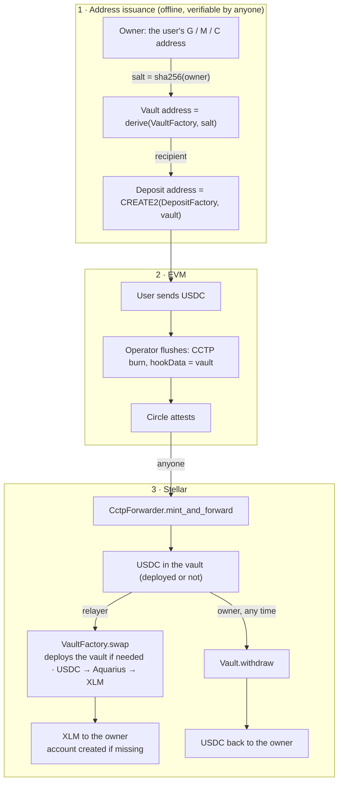

# Cross Mesh Ingress — Stellar side: XLM delivery

A new Stellar account cannot receive anything until it holds XLM. This directory lets a USDC deposit on an
EVM chain arrive on Stellar **as XLM**, creating the recipient's account if it does not exist yet. Funds can
only go to the user: no key held by Cross Mesh or anyone else can send them anywhere else. The relayer that
converts them chooses when and through which venue, but is bound by an oracle price floor; the exact worst
case is in `docs/DESIGN.md` §6.

The deposit address commits the user's **vault** — a tiny Soroban contract at an address derived from the
user's own Stellar address — instead of the user's address. Circle's forwarder mints the USDC into the vault
and a relayer-triggered, oracle-bounded swap turns it into XLM for the user. Until that swap happens, the user
can withdraw the USDC instead, once their account exists.



Address derivation, the contracts, the trust model and deployment: [`docs/DESIGN.md`](docs/DESIGN.md).

## Contracts

| Crate | Path | Role |
|-------|------|------|
| `crossmesh-interfaces` | `packages/interfaces` | `VaultConfig` and the cross-contract client traits |
| `vault` | `contracts/vault` | per-owner stateless vault: `swap` (factory-only, oracle-bounded) and `withdraw` (owner-only) |
| `vault-factory` | `contracts/vault-factory` | immutable config (except the capped discount), owner-derived deployment, relayer set, `swap` |
| `aquarius-filler` | `contracts/aquarius-filler` | swaps through the Aquarius router along a route passed per call; serves vault code only |
| `test-support` | `packages/test-support` | test-only ledger helpers |

## Build and test

The toolchain is pinned in `rust-toolchain.toml`. `stellar-cli` is required (`brew install stellar-cli`; the
version CI uses is in `.github/workflows/stellar.yml`) because `soroban-sdk` builds wasm only through
`stellar contract build`.

```sh
make test       # cargo test
make fmt-check  # cargo fmt --all -- --check
make lint       # cargo clippy --all-targets -- -D warnings
make build      # stellar contract build → target/wasm32v1-none/release/*.wasm
```

Deployment from a release: `uv run stellar/script/deploy.py --help` and `docs/DESIGN.md` §7.
