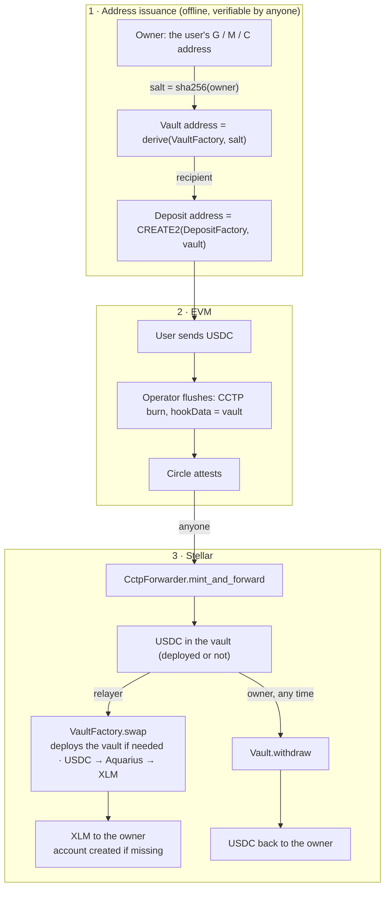

# XLM Delivery via Per-Recipient Stellar Vaults — Design

The contracts' doc comments are the detailed reference; this document records the design and its reasons.

---

## 1. Goal and constraints

A depositor sends USDC on an EVM chain and the Stellar recipient receives **XLM**. If the recipient's account
does not exist yet, the delivery creates it — which is what makes this mode useful for onboarding; existing
accounts are served the same way.

1. No key held by Cross Mesh or anyone else can divert the principal; the only destination is the user.
2. The full amount is converted to XLM.
3. Keep it simple: no upgrade paths, no migration machinery, no code for hypothetical venues.

---

## 2. What the design relies on

- The EVM contracts commit any Stellar strkey (G, M or C) as the recipient, and Circle's `CctpForwarder`
  pays it with a plain SAC transfer — including a contract address that has no code yet. The forwarder is
  permissionless; anyone may submit the mint.
- A new account can only be reached with XLM: USDC needs a trustline, which nothing creates automatically,
  while a native-XLM transfer of at least 1 XLM creates the account itself (CAP-0073). That minimum is a
  network parameter and can change with the protocol, but it has stood at 1 XLM for years.
- A contract's address depends only on its deployer and a salt, so it can be computed before deployment,
  and only that deployer can deploy there.

---

## 3. Architecture

Each XLM-mode user gets a **vault**: a tiny, non-upgradable Soroban contract at an address derived from the
user's own Stellar address through the non-upgradable `VaultFactory`. The EVM deposit address is the ordinary
one, with the vault's `C…` strkey as the committed recipient. Circle's forwarder delivers the
USDC into the vault; the relayer calls `swap`, which hands the USDC to a replaceable **filler** (an Aquarius
adapter), verifies by the vault's own XLM balance and against a Reflector price floor that enough came back,
and pays the XLM to the user — creating the account if needed. The only other exit is `withdraw`, signed by
the user, which returns the USDC unchanged.



Mint and swap are separate transactions on purpose: a failed swap simply leaves the USDC in the vault for a
retry, and whatever USDC a vault holds belongs to its owner, so nothing has to be paired with a message.

---

## 4. Address derivation (normative)

Implemented identically by the factory, the backend and the verify SDK.

**4.1 Owner.** The user's own G, M or C strkey, validated like today's recipient and used verbatim. The
protocol refuses no owner: where the XLM goes is the owner's decision.

**4.2 Salt.** `salt = sha256(ascii_bytes(owner_strkey))` — the strkey's ASCII bytes, the same encoding the EVM
side uses for recipients.

**4.3 Vault address.**

```
preimage = HashIdPreimage::ENVELOPE_TYPE_CONTRACT_ID { network_id = sha256(passphrase),
             contract_id_preimage = ContractIdPreimage::Address { address = VaultFactory, salt } }
vault    = strkey_C( sha256( xdr(preimage) ) )     // on-chain: deployer().with_current_contract(salt).deployed_address()
```

The passphrase is in the preimage, so the same owner has different vaults on mainnet and testnet.

**4.4 Deposit address.** The EVM `DepositFactory`'s CREATE2 derivation, with the vault strkey as the recipient.

---

## 5. Contracts

Rust, `soroban-sdk` 29, workspace `stellar/`. No upgrade path anywhere; vaults run a fixed
`ContractExecutable::Wasm`.

### 5.1 `VaultFactory`

One per network: the immutable configuration, the relayer set, vault deployment, and the only caller of
`Vault.swap`. It takes no part in the mint.

```rust
pub struct VaultConfig {
    pub usdc: Address,              // USDC SAC
    pub xlm: Address,               // native XLM SAC
    pub vault_wasm_hash: BytesN<32>,// the only code a vault can ever run
    pub oracle: Address,            // Reflector Pulse feed (§5.4)
    pub xlm_asset: OracleAsset,     // how XLM is identified in that feed
    pub usdc_asset: OracleAsset,    // how USDC is identified in the same feed (both prices are read)
    pub discount_ppm: u32,          // millionths like the EVM Config's feePpm; admin-tunable, at most DISCOUNT_CAP_PPM
    pub max_price_age: u64,         // seconds, at most MAX_PRICE_AGE_CAP (§7)
    pub min_delivery: i128,         // stroops of XLM (§7)
}
```

Two bounds are fixed in code rather than configured: `DISCOUNT_CAP_PPM` = 100_000 (10 %) and
`MAX_PRICE_AGE_CAP` = 900 s. The factory refuses a configuration beyond them and the vault re-checks every
configuration it receives, so they hold for every deployment of the released wasm.

| Function | Who | What |
|----------|-----|------|
| `vault_address(owner)` | anyone | §4; rejects malformed owners |
| `deploy(owner)` | anyone | deploys the fixed wasm at the derived address if absent; idempotent; no registry — the `Deployed` event is the index |
| `swap(relayer, owner, amount?, filler, min_out, data)` | an enabled relayer | `deploy` if needed, then `Vault.swap` with the factory's config; `amount = None` = the whole USDC balance |
| `set_relayer`, `set_discount` (≤ cap), `set_admin` (two-party) | admin | the only mutable state |

Why: `deploy` is permissionless because code and owner are fixed, so anyone may deploy a vault — which is
all an owner needs in order to `withdraw` if Cross Mesh never does. Relayers are admin-managed so key
rotation needs no new factory; a relayer can only trigger a `swap`, bounded by the discount (§6). The
discount is tunable because the right value follows the market; its cap is fixed in code, so it is the same
for every deployment. There is no pause switch: disabling every relayer halts swaps, and nothing can halt
`withdraw`. The vault does not check relayers itself — re-entry is forbidden, so `Vault.swap` accepts the
factory alone and the factory is the single place where relayers are checked.

### 5.2 `Vault`

One per owner, **stateless**: no constructor, no storage. Every call passes `owner` and `factory`, and the
vault checks that `(factory, sha256(owner))` derives to its own address (`NotThisVault`), which proves both
who deployed it and who owns it. The configuration arrives with each `swap` from the immutable factory.

- `swap(owner, factory, relayer, filler, amount, min_out, data, config)`, factory-only:
  `want = max(min_out, floor)` (§5.4), at least `min_delivery`; the USDC goes to `filler`, whose `fill` must
  return XLM within the same invocation; the vault trusts only its own balance delta (`FillShortfall`
  otherwise); then it pays its **entire** XLM balance to the owner, creating the account if needed.
  Returns this swap's delivery; the event also reports the total paid out. Partial amounts allow batches.
- `withdraw(owner, factory, token)`, owner-only: returns the whole balance of `token` to the owner. No
  destination, no amount. For a G/M owner impossible before the account exists or without a trustline; a C
  owner needs neither but must be able to authorize (`__check_auth` or a direct call).

### 5.3 Fillers

One interface; venue specifics live in replaceable adapters that never hold funds beyond a single call:

```rust
/// Precondition: `amount_in` of `token_in` has been transferred to this contract.
/// Postcondition: at least `min_out` of `token_out` has been transferred to `recipient`.
fn fill(e, recipient, token_in, amount_in, token_out, min_out, data: Bytes) -> i128;
```

Every adapter serves vault code only (`recipient.require_auth()` plus
`recipient.executable() == Wasm(vault_wasm_hash)`), passes `min_out` down to the venue, and never calls the
factory during a swap.

**`AquariusFiller`** (launch venue): `data` is the route as the XDR of `Vec<(pool tokens, pool hash, token
out)>` — exactly the `swap_chain_xdr` of Aquarius's `find-path` API, so new pools need no new adapter. It
pre-authorizes exactly one `token_in.transfer(adapter, router, amount_in)`, calls `swap_chained` with
`min_out` as `out_min`, requires the router to have taken exactly `amount_in`, and forwards its output
balance delta to the vault. Immutable; retired by pointing the relayer elsewhere.

### 5.4 Oracle floor (Reflector Pulse)

```
px = lastprice(xlm_asset), pu = lastprice(usdc_asset)   ; each: present, price > 0,
                                                         ;   timestamp ≤ now + 60 s and now − timestamp ≤ max_price_age
floor = amount × pu.price × (1_000_000 − discount_ppm) / (px.price × 1_000_000)
```

One feed for both quotes and 7 decimals on both tokens, so nothing needs scaling; reading USDC too means a
de-peg lowers the floor instead of freezing swaps. The CEX-aggregate feed is used rather than Reflector's
Stellar-DEX feed: the latter prices the exact pair but can be moved for a 5-minute window with far less
capital. A stalled feed fails the age check and `swap` reverts cleanly. The dangerous failure is a **wrong
but fresh** price (§6).

### 5.5 Rent

Soroban charges rent per byte kept in the ledger, for at least 120 days on mainnet, and there is one vault
per user. Hence the vault stores nothing (its instance is ~100 bytes), the factory keeps no per-vault
registry, and no contract extends TTLs from inside a call — `extend_ttl` on an instance also extends the
shared code entry, which would put a large, unpredictable rent bill on a random transaction. The operator
keeps the factory, the filler and the code entries alive; a vault may archive after 120 idle days and is
restored automatically by the next transaction that touches it.

---

## 6. Trust model

**Invariants.** I1: USDC leaves a vault only via `swap` (to the filler, within the invocation that must
return XLM) or `withdraw` (to the owner). I2: XLM leaves a vault only to the owner. I3: a vault's code and
owner are fixed, nothing is upgradable, and the address depends on nothing else. I4: every `swap` delivers
at least `max(min_out, floor)`, the floor being an oracle price at most `max_price_age` old minus
`discount_ppm`; the code caps these at 900 s and 10 %.

| Party | Can | Cannot |
|-------|-----|--------|
| User (owner) | receive XLM; `withdraw` once the account exists and has a trustline; `deploy` or `mint_and_forward` themselves | change the owner, redirect anything |
| Cross Mesh relayer (hot key) | choose when to swap, in what batches, through which filler, at what `min_out ≥ floor` | take principal; pay anyone but the owner; exceed the current discount plus the price move since the oracle's last update |
| Cross Mesh factory admin (cold key) | add/remove relayers (removing every relayer halts swaps); move `discount_ppm` within the cap; hand over admin | change the cap, oracle, assets, wasm; upgrade; block `withdraw`; touch vaults |
| Any third party | `deploy` a vault; `mint_and_forward`; donate | anything else |
| Circle | pause/upgrade its forwarder; freeze (and, if its issuer flags allow, claw back) USDC balances as the issuer — the powers it has over every USDC holder today | touch XLM, or send USDC anywhere |
| Reflector DAO | determine the price floor | move funds |

**Worst cases.** A compromised relayer skims at most the current `discount_ppm` plus the XLM/USD move since
the oracle's last update (a record may be up to `max_price_age` old, and the relayer picks the moment) per
settlement while the oracle is honest; a compromised admin on top raises the discount part to the 10 % cap;
neither reaches the principal. A hostile filler or venue is held to the same floor, since `want` is passed
down as its minimum output. A wrong **but updating** oracle leaves `min_out` as the only protection: the
single trust point of the design, accepted consciously. A stopped oracle stops swaps; funds stay safe. A
fresh user cannot act until the account exists; if Cross Mesh disappears, anyone can activate the account
with a couple of XLM and the user `withdraw`s — the same position new users are in with the USDC product.

Compared with the EVM side, "no key can divert the principal" holds with one qualification: within the
discount, the conversion rate is at the relayer's discretion. The 10 % cap comes with the code; users verify
the oracle and the vault code hash in the immutable factory config, as they verify fee caps in `Config` today.

**Where funds can get stuck.** A C owner that can neither call `withdraw` itself nor implement
`__check_auth` depends on the relayer forever, and a C owner that cannot use XLM (a token or pool contract)
loses the XLM: the protocol refuses no owner, so address issuers should not accept such owners. A remainder
below `min_delivery`, after a partial batch or a tiny deposit, cannot be swapped on its own and waits for
the next deposit or the owner's `withdraw`; the relayer should swap whole balances.

---

## 7. Deployment

Per network: upload the three codes → deploy `VaultFactory(admin, config)` → `set_relayer` → deploy
`AquariusFiller(router, vault_wasm_hash)`. Vaults are deployed lazily by the first swap. `stellar/script/deploy.py`
does this from a release, signing with a secret key, a seed phrase or a Ledger, in two steps:

```sh
uv run stellar/script/deploy.py upload --network <testnet|mainnet> --tag <tag> --signer <key|mnemonic|ledger>
uv run stellar/script/deploy.py deploy --network <testnet|mainnet> --tag <tag> --signer <key|mnemonic|ledger> --relayer G…
```

It verifies the release's build attestations, skips whatever is already on chain, and ends by reading back every
code hash and configuration value; `verify --deployer G…` repeats that check with no key at all. Deploy only wasm
from a GitHub release: a `stellar-v<version>` tag runs `.github/workflows/stellar-release.yml`, StellarExpert's
reproducible build with attestation, which is what StellarExpert validates deployed contracts against. The
wasm embeds the doc comments of `vault` and `crossmesh-interfaces`, so editing them changes `vault_wasm_hash`
and with it every vault address: freeze both before tagging.

| Parameter | Value |
|-----------|-------|
| `usdc`, `xlm` | the USDC and native XLM asset contracts (`../deployments/README.md`) |
| `vault_wasm_hash` | hash of the released `vault.wasm` |
| `oracle` | Reflector CEX Pulse feed: mainnet `CAFJZQWSED6YAWZU3GWRTOCNPPCGBN32L7QV43XX5LZLFTK6JLN34DLN`, testnet `CCYOZJCOPG34LLQQ7N24YXBM7LL62R7ONMZ3G6WZAAYPB5OYKOMJRN63` |
| `xlm_asset`, `usdc_asset` | `Other("XLM")`, `Other("USDC")` |
| `discount_ppm` | ≈ 10_000 (1 %); the code accepts at most 100_000 (10 %) |
| `max_price_age` | 360 s: the Reflector feed publishes every 5 minutes, so this allows one update plus a minute of slack; the code accepts at most 900 s |
| `min_delivery` | 20_000_000 (2 XLM: reserve, one trustline and fees) |
| Aquarius router (filler constructor) | mainnet `CBQDHNBFBZYE4MKPWBSJOPIYLW4SFSXAXUTSXJN76GNKYVYPCKWC6QUK`, testnet `CBCFTQSPDBAIZ6R6PJQKSQWKNKWH2QIV3I4J72SHWBIK3ADRRAM5A6GD` |

Everything but `discount_ppm` is immutable; a change means a new factory and therefore new vault and
deposit addresses.
