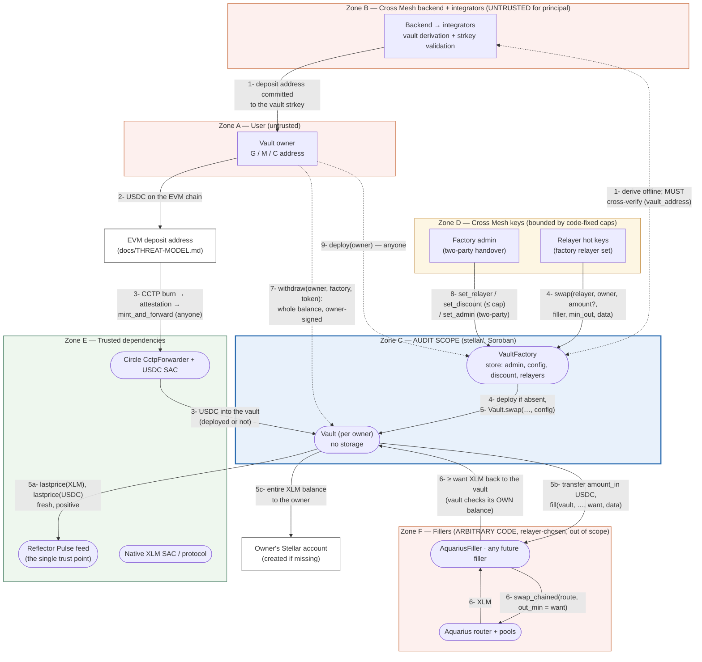

# Cross Mesh Ingress — Stellar XLM delivery: STRIDE Threat Model

> The latest version of this document is maintained online at
> [github.com/lightsail-network/crossmesh-ingress-contracts — stellar/docs/THREAT-MODEL.md](https://github.com/lightsail-network/crossmesh-ingress-contracts/blob/main/stellar/docs/THREAT-MODEL.md).
> The EVM half of the product — deposit addresses, CCTP burn, fees — has its own model in
> [`docs/THREAT-MODEL.md`](../../docs/THREAT-MODEL.md); this document starts where that one ends, with USDC
> arriving on Stellar.

## Scope

- **In scope (the audit target):** the two Soroban contracts that hold trust in `stellar/` — `Vault`
  (`contracts/vault`, one stateless instance per user) and `VaultFactory` (`contracts/vault-factory`, one
  per network) — together with `crossmesh-interfaces` (`packages/interfaces`), the crate of types and
  cross-contract client traits compiled into both, all as built by the toolchain pinned in
  `stellar/rust-toolchain.toml` and released by `.github/workflows/stellar-release.yml` (Appendix A).
- **Parties:** _Cross Mesh_ operates the system — it holds the `VaultFactory` admin key and the relayer
  keys, runs the backend that derives addresses, and runs the relayer that triggers swaps. _Integrators_
  obtain deposit addresses through its API and hand them to _users_ (the vault owners). Neither party is
  trusted with principal.
- **Fillers are out of scope and modeled as arbitrary code.** `AquariusFiller` (`contracts/aquarius-filler`)
  is the launch venue adapter and ships in this repository, but it is not part of the audit target, and
  neither is any filler added later. The filler is a per-call argument chosen by the relayer; the property
  this model demonstrates — and the one the audit is asked to confirm — is that **the vault's guarantees
  hold for an arbitrary `filler` address, including one written by an attacker**: the vault accepts a
  fill only by measuring its own XLM balance, reverts atomically otherwise, grants the filler no
  authorization beyond the single transfer it makes itself, and pays its whole XLM balance to an owner the
  filler cannot choose (Elevation.3). A hostile filler is therefore a special case of a hostile relayer,
  never a new trust tier. Fillers hold no funds between calls; their failure modes are liveness only.
- **Out of scope, modeled as adversarial or as a trusted dependency:** the Cross Mesh backend and relayer
  software and the custody of the admin and relayer keys (adversarial); the Aquarius router and pools
  behind the launch filler (adversarial, reached only through a filler); Reflector's price feed (**the one
  trusted dependency the design accepts**, Tamper.6); Circle's `CctpForwarder` and its issuer powers over
  USDC, and the Stellar protocol itself including the native-XLM and USDC Stellar Asset Contracts
  (trusted platform). The EVM contracts that get the USDC here are covered by their own model.
- **What this model demonstrates.** With the relayer, the admin and the filler all adversarial, the four
  invariants of the design (`stellar/docs/DESIGN.md` §6) hold: **I1** USDC leaves a vault only through
  `swap` (to the filler, inside the invocation that must return XLM) or `withdraw` (to the owner); **I2**
  XLM leaves a vault only to the owner; **I3** a vault's code and owner are fixed, nothing is upgradable,
  and its address depends on nothing else; **I4** every `swap` delivers at least `max(min_out, floor)`,
  the floor being an oracle price at most `max_price_age` old minus `discount_ppm`, both capped in code
  (900 s, 10 %). Principal is never diverted; the only value any key can extract is the discount plus
  the price move since the oracle's last update, per settlement, while the oracle is honest.

---

## 1. What are we working on?

A depositor sends USDC on an EVM chain to an ordinary deposit address whose committed Stellar recipient is
a **vault**: a tiny, stateless, non-upgradable Soroban contract at an address derived from the user's own
Stellar address (`salt = sha256(owner strkey)`, deployer = the immutable `VaultFactory`). Circle's
`CctpForwarder` mints the USDC into the vault — deployed or not — in its own, permissionless transaction.
Later, in a second transaction, a Cross Mesh relayer calls `VaultFactory.swap`, which deploys the vault if
needed and calls `Vault.swap`: the vault hands the USDC to the relayer-chosen filler, verifies **by its own
XLM balance** that at least `want = max(min_out, floor)` came back, and pays its **entire** XLM balance to
the owner, creating the owner's account if it does not exist (CAP-0073). The only other exit is
`Vault.withdraw`, signed by the owner, which returns the whole balance of any token unchanged.

Two things make the design small enough to reason about:

- **The vault stores nothing.** Every call passes `owner` and `factory` as arguments and the vault checks
  that `(factory, sha256(owner))` derives to its own address (`NotThisVault`). A match proves both who
  deployed it and who owns it; there is no constructor, no instance storage, no admin and no upgrade
  path. The configuration arrives with each `swap` from the factory, which is the only party allowed to
  call it.
- **The factory is immutable except for three knobs.** `VaultConfig` — USDC and XLM asset contracts, the
  vault code hash, the oracle and its asset identifiers, `max_price_age`, `min_delivery` — is fixed at
  construction. The admin can add and remove relayers, move `discount_ppm` up to the code-fixed
  `DISCOUNT_CAP_PPM` (10 %), and hand over the admin role with the new admin's signature. Nothing else.

There is no pause switch: disabling every relayer halts swaps, and nothing can halt `withdraw`.

### Components

| Element (DFD type) | Role |
|---|---|
| User / vault owner (external entity) | Receives XLM; may `withdraw` USDC (or any token) once able to sign; may `deploy` their own vault |
| Cross Mesh backend + integrator SDK (external entity) | Derive the vault address from the owner strkey and commit it as the EVM deposit address's recipient; **untrusted for principal** |
| Relayer hot keys (external entity) | Enabled in the factory's relayer set; the only callers of `VaultFactory.swap`; choose timing, batch size, filler, `min_out` and route |
| Factory admin (external entity) | Governance over the relayer set and `discount_ppm` (≤ cap); two-party handover |
| `VaultFactory` (process + data store) | Immutable `VaultConfig`; `vault_address` / `deploy` (permissionless); `swap` (relayer-only); the only caller of `Vault.swap`. Storage: admin, config, discount override, relayer flags |
| `Vault` (process) | Stateless per-owner contract: `swap` (factory-only, oracle-bounded, filler-agnostic) and `withdraw` (owner-only) |
| Filler — `AquariusFiller` or any other (external process, **arbitrary code**) | Receives `amount_in` USDC from the vault and must return XLM to it within the same invocation; chosen per call by the relayer; out of scope |
| Aquarius router + pools (external process) | The launch venue behind `AquariusFiller`; reached only through a filler |
| Reflector Pulse feed (external process, trusted dependency) | SEP-40 `lastprice` for XLM and USDC against USD; defines the floor |
| Circle `CctpForwarder` + USDC SAC (external process) | Mints USDC into the vault (`mint_and_forward`, permissionless); Circle keeps its issuer powers over USDC |
| Native XLM SAC / Stellar protocol (external process) | Account creation on XLM transfer (CAP-0073); re-entry prohibition; rent and TTL rules |

### Data flow diagram

Zone colors encode the trust stance: **blue = the audited contracts**, red = adversarial actors — the
fillers deliberately among them —, amber = Cross Mesh keys (bounded by code-fixed caps), green = trusted
dependencies. The owner's account sits outside every zone: delivery there is the end state this model
protects.

Numbered flows (threats in §2 reference these):

1. Cross Mesh's backend derives the vault address for the owner strkey — `salt = sha256(ascii(owner))`,
   deployer = `VaultFactory`, network passphrase in the preimage — and **cross-verifies it against the
   on-chain `VaultFactory.vault_address(owner)`**, then commits that vault's `C…` strkey as the recipient
   of an ordinary EVM deposit address and issues the address to the integrator.
2. The user sends USDC to the deposit address on the EVM chain; the EVM model takes it from there
   (flush, CCTP burn, attestation).
3. Anyone submits `mint_and_forward` to Circle's `CctpForwarder`, which transfers the USDC to the vault
   address — whether or not the vault is deployed. No contract in this repository takes part.
4. A relayer calls `VaultFactory.swap(relayer, owner, amount?, filler, min_out, data)`. The factory
   verifies the relayer's signature and enabled status, deploys the vault if absent, resolves
   `amount = None` to the vault's whole USDC balance, and calls `Vault.swap` with its own config.
5. `Vault.swap` checks that `(factory, sha256(owner))` derives to its own address and that the factory is
   the direct invoker, re-checks the config bounds, **(5a)** reads both prices from Reflector and computes
   `floor`, sets `want = max(min_out, floor)` (≥ `min_delivery`), **(5b)** transfers `amount` USDC to the
   filler and calls `fill(vault, usdc, amount, xlm, want, data)`, requires its own XLM balance to have
   grown by at least `want`, and **(5c)** transfers its entire XLM balance to the owner, creating the
   account if needed. Any failure reverts everything, the USDC transfer included.
6. Inside `fill`, the filler does whatever it does — the launch adapter pre-authorizes one
   `transfer(adapter, router, amount_in)`, calls Aquarius with `out_min = want`, and forwards its output
   balance delta to the vault. The vault neither reads nor trusts any of it.
7. Escape hatch: the owner calls `Vault.withdraw(owner, factory, token)` at any time and receives the
   whole balance of `token` — normally the USDC that has not been swapped. No destination, no amount.
8. Governance: the admin calls `set_relayer`, `set_discount` (rejected above the cap) or `set_admin`
   (which the new admin must also sign).
9. Side flow: anyone may call `VaultFactory.deploy(owner)`; it is idempotent and deploys the fixed code at
   the derived address. The operator keeps the factory, the filler and the three code entries alive with
   `ExtendFootprintTTL` operations; no contract extends TTLs itself.

### Data entities

| Entity | Where it lives | Integrity anchor |
|---|---|---|
| USDC principal | Vault balance in the USDC SAC (flows 3–5, 7) | Leaves only via `swap` (to the filler, inside an invocation that must return XLM, else reverts) or `withdraw` (to the owner); no entrypoint takes a destination |
| XLM proceeds | Vault balance in the native SAC, transiently (flows 5c, 6) | The vault pays its entire balance to the owner derived from its own address; the filler's output is measured, not reported |
| Owner ↔ vault binding | Protocol address derivation (flows 1, 5, 7) | `(factory, sha256(owner))` must derive to the vault's address on every call; no stored owner to tamper with; verifiable offline and via `vault_address` |
| `VaultConfig` | Factory instance storage (flows 4–5) | Set once in the constructor with mis-wiring checks; only `discount_ppm` is mutable, ≤ `DISCOUNT_CAP_PPM`; the vault re-checks the bounds on every `swap` |
| Relayer set, admin | Factory instance storage (flows 4, 8) | Admin-only setters, every change emits an event; `set_admin` needs both signatures |
| Oracle price records | Reflector contract (flow 5a) | Both records must exist, be positive, not be from the future (60 s skew) and be at most `max_price_age` old (≤ 900 s) |
| Route `data`, `min_out`, `amount`, `filler` | Relayer's call arguments (flows 4–6) | Opaque or bounded: `want ≥ floor` regardless of `min_out`; `amount ≤ balance`; the filler is arbitrary by design; `data` never reaches the vault's logic |

### Trust boundaries

| # | Boundary | Trust stance |
|---|---|---|
| TB1 | User ↔ integrator ↔ Cross Mesh backend (flow 1) | **Untrusted.** A lying address distributor is a residual path to principal loss (Spoof.1), as on the EVM side |
| TB2 | Anyone ↔ `deploy`, anyone ↔ `mint_and_forward` (flows 3, 9) | Permissionless by design; harmless because code, owner and destination are fixed |
| TB3 | Relayer ↔ `VaultFactory.swap` (flow 4) | Semi-trusted: may _time_ and _batch_ settlements and pick venue and `min_out`; bounded by the oracle floor; cannot redirect |
| TB4 | Admin ↔ factory setters (flow 8) | Semi-trusted: bounded by code-fixed caps; cannot touch the config beyond `discount_ppm`, nor any vault |
| TB5 | Vault ↔ filler (flows 5b, 6) | **Adversarial.** Arbitrary code receives the USDC; the vault's guarantees do not depend on it (Elevation.3) |
| TB6 | Vault ↔ Reflector (flow 5a) | **Trusted dependency — the single trust point.** Bounded by freshness and sign checks and by the relayer's `min_out`; a wrong-but-fresh price is the accepted residual (Tamper.6) |
| TB7 | Contracts ↔ Stellar protocol and SACs (flows 3, 5c, 7) | Trusted platform: Circle's issuer powers over USDC apply to every holder; CAP-0073 account creation; host re-entry prohibition; rent |
| TB8 | EVM contracts ↔ this system (flows 2–3) | Covered by `docs/THREAT-MODEL.md`; this model assumes only that USDC can arrive at a vault address |

---

## 2. What can go wrong?

STRIDE applied per flow. IDs below are referenced by the remediations in §3.

### Spoofing

| ID | Threat (flow) |
|---|---|
| Spoof.1 | A compromised/hostile distributor issues a deposit address committed to a vault derived from the **attacker's** owner; the XLM goes to the attacker (flow 1) |
| Spoof.2 | A non-relayer, or someone naming a relayer they do not control, calls `VaultFactory.swap` (flow 4) |
| Spoof.3 | Something other than the deploying factory calls `Vault.swap`, or a call names a different `owner`/`factory` pair to make the vault pay someone else (flow 5) |
| Spoof.4 | Someone other than the owner calls `withdraw`, or claims a muxed owner's funds (flow 7) |
| Spoof.5 | An attacker pre-deploys or front-runs a victim's vault with other code or another owner (flow 9) |

### Tampering

| ID | Threat (flow) |
|---|---|
| Tamper.1 | Change a vault's owner or code after its address was issued (flows 1, 5, 7) |
| Tamper.2 | Feed `Vault.swap` a forged `VaultConfig` — another oracle, other asset contracts, a discount above the cap — or deploy a look-alike vault from a hostile factory (flow 5) |
| Tamper.3 | The admin raises `discount_ppm` beyond what users verified (flow 8) |
| Tamper.4 | The relayer pushes the deliverable down with `min_out = 0`, a tiny `amount`, or a hostile route (flows 4–6) |
| Tamper.5 | The filler reports an inflated output or otherwise corrupts the vault's accounting (flow 6) |
| Tamper.6 | The oracle record is stale, from the future, zero, negative, or wrong but fresh; or USDC de-pegs (flow 5a) |

### Repudiation

| ID | Threat (flow) |
|---|---|
| Repudiate.1 | A dispute over the rate at which a swap was executed cannot be settled from public data (flow 5) |
| Repudiate.2 | A dispute over whether a vault was deployed, which relayers were enabled, or when the discount changed (flows 8, 9) |

### Information disclosure

| ID | Threat (flow) |
|---|---|
| Info.1 | The owner ↔ vault ↔ deposit-address linkage is publicly enumerable (derivation, `Deployed` and `Swapped` events), deanonymizing users (flows 1–5) |

### Denial of service

| ID | Threat (flow) |
|---|---|
| DoS.1 | The relayer goes offline, or every relayer is disabled, and no swap ever happens (flow 4) |
| DoS.2 | Reflector stalls, drops an asset, or is paused; `swap` cannot compute a floor (flow 5a) |
| DoS.3 | The filler or its venue is broken, hostile, or exceeds the transaction's resource limits; `swap` fails (flows 5b, 6) |
| DoS.4 | The owner cannot `withdraw`: a G/M account that does not exist yet or holds no USDC trustline (flow 7) |
| DoS.5 | A remainder below `min_delivery` — a tiny deposit or the tail of a partial batch — cannot be swapped on its own (flow 5) |
| DoS.6 | Rent: a vault instance, the factory, or a code entry is archived (flow 9) |
| DoS.7 | Circle pauses its forwarder, or freezes or claws back the vault's USDC (flow 3) |
| DoS.8 | A malformed or unusable owner is committed: a strkey the factory rejects, a C owner that cannot authorize, or one that cannot use XLM (flows 1, 5c, 7) |
| DoS.9 | A wrong value in the immutable `VaultConfig` — an impostor asset contract, a wrong oracle asset id — is latched at construction (flow 8, Appendix A) |
| DoS.10 | USDC is mis-sent to the factory or to a filler, which have no exit for it (flows 3, 6) |

### Elevation of privilege

| ID | Threat (flow) |
|---|---|
| Elevation.1 | A compromised relayer key abuses `swap` (flow 4) |
| Elevation.2 | A compromised admin key abuses `set_relayer`, `set_discount`, `set_admin` (flow 8) |
| Elevation.3 | **A hostile filler** keeps the USDC, pays short, re-enters the vault, borrows the vault's authorization to pull more, or redirects the XLM (flows 5b, 6) |
| Elevation.4 | A third party gains something over a vault through the permissionless `deploy` or `mint_and_forward`, or by donating tokens to it (flows 3, 9) |
| Elevation.5 | Relayer and admin collude (the combined worst case) (flows 4, 8) |

---

## 3. What are we going to do about it?

Every treatment below is **implemented and tested** unless marked _risk accepted_. Test names refer to
`contracts/vault/src/test.rs` (vault) and `contracts/vault-factory/src/test.rs` (factory).

### Spoofing

- **Spoof.1.R.1** — A vault address is protocol math over public inputs — the factory address, the
  network passphrase and `sha256` of the owner strkey's ASCII bytes (`DESIGN.md` §4) — so anyone can
  recompute it fully **offline**. `VaultFactory.vault_address(owner)` is the on-chain reference and rejects
  malformed strkeys; the verify SDK implements the same derivation, locked by a shared test vector
  (`vault_address_matches_the_javascript_test_vector`). **Integrators MUST cross-verify every address they
  hand out:** the vault derived from the user's own address must match the recipient committed in the EVM
  deposit address (`recipient()` there), and both must match the offline derivation.
- **Spoof.1.R.2** — A user can verify before funding: derive their vault from their own strkey, compare it
  with the deposit address's committed recipient, and read `vault_address` on the canonical factory.
- **Spoof.1.R.3** — _Risk accepted (residual):_ on-chain code cannot detect a poisoned address — it is a
  _valid_ vault, just not the user's. Correctly derived addresses already issued are unaffected by any
  later distributor compromise.
- **Spoof.2.R.1** — `VaultFactory.swap` calls `relayer.require_auth()` and then checks the relayer set
  (`NotRelayer`): naming a relayer without its signature fails at the host, and a signature from an
  address that is not enabled fails in the contract. The vault itself never checks relayers — it accepts
  `swap` from the factory alone (Spoof.3), so the relayer set is enforced in exactly one place. Covered by
  `swap_is_relayer_only_and_reaches_the_vault_through_the_factory` and
  `swap_requires_the_relayer_signature`.
- **Spoof.3.R.1** — `Vault.swap` and `Vault.withdraw` begin with `require_this_vault`: `(factory,
  sha256(owner))` must derive to the vault's own address, else `NotThisVault`. A different owner or a
  different factory produces a different address, so the pair cannot be swapped out for one that pays
  someone else; a match proves both who deployed the vault and who owns it (anything else is a hash
  collision). `swap` additionally calls `factory.require_auth()`, which a contract address satisfies only
  as the direct invoker (the factory never issues sub-invocation authorizations), so neither a relayer
  nor the filler nor anyone else can call the vault directly. Covered by
  `calls_with_another_owner_or_another_factory_are_rejected_before_anything_else` and
  `swap_rejects_every_caller_but_the_factory`.
- **Spoof.4.R.1** — `withdraw` requires the owner's authorization on the address parsed from the committed
  strkey: for a G owner the account signs, for an M owner the underlying G account signs, for a C owner
  the contract authorizes via `__check_auth` or by invoking directly. The destination is that same owner;
  there is no destination parameter. Covered by `withdraw_requires_the_owner_signature`,
  `withdraw_for_a_muxed_owner_is_signed_by_the_base_account` and
  `withdraw_to_a_contract_owner_needs_no_trustline`.
- **Spoof.5.R.1** — Deployment is permissionless _and harmless_: only the factory can deploy at the derived
  address (it is the deployer in the preimage), the code is the factory's immutable `vault_wasm_hash`,
  there are no constructor arguments, the owner is fixed by the salt, and `deploy` is idempotent. A
  pre-deployed vault is the vault. Covered by `deploy_is_deterministic_idempotent_and_initialises_the_vault`
  and `vault_address_and_deploy_accept_g_m_and_c_owners`.

### Tampering

- **Tamper.1.R.1** — There is nothing to change: the vault has no storage, no admin and no upgrade path;
  its owner is an input to its own address; its code is `ContractExecutable::Wasm(vault_wasm_hash)` from
  an immutable factory field. Changing the vault code means a new factory and therefore new vault and
  deposit addresses — never a change under an issued address (I3).
- **Tamper.2.R.1** — The config reaches a vault only through `Vault.swap`, which only the deploying factory
  can call (Spoof.3), and the factory passes its own stored config with the current discount applied.
  Defense in depth: the vault re-checks the code-fixed bounds on every call — `discount_ppm ≤ 10 %`,
  `0 < max_price_age ≤ 900 s`, `min_delivery > 0`, `usdc ≠ xlm` — and refuses otherwise
  (`InvalidConfig`). Covered by `swap_rejects_a_config_whose_discount_exceeds_its_cap` and
  `swap_rejects_an_unusable_config`.
- **Tamper.2.R.2** — A hostile factory can deploy vaults with any config it likes, but only at addresses
  derived from _itself_: the identity check binds every vault to its deploying factory, so no look-alike
  can stand in for a vault derived from the canonical factory. Addresses are issued only for the canonical
  factory of each network, verified after deployment (Appendix A).
- **Tamper.3.R.1** — `set_discount` is admin-only and refuses anything above `DISCOUNT_CAP_PPM`
  (`AboveCap`); the cap is a constant of the released wasm, not a deployment parameter, and the factory
  constructor rejects a starting value above it too. The worst case any user has to verify is the cap:
  10 % below the oracle price. Every change emits `DiscountSet`. Covered by
  `set_discount_is_admin_only_bounded_by_the_cap_and_used_by_the_next_swap` and
  `constructor_rejects_a_discount_above_the_cap`.
- **Tamper.4.R.1** — `min_out` is the relayer's own, _additional_ floor: the effective requirement is
  `want = max(min_out, floor)`, so `min_out = 0` falls back to the oracle floor and can never lower it, and
  `want` must also reach `min_delivery` (`BelowMinDelivery`). `amount` must be positive and at most the
  balance (`InvalidAmount`, `InsufficientBalance`); a partial amount is a batch, and the remainder stays in
  the vault, where it still belongs to the owner. `data` is opaque to the vault; the worst a route can do
  is deliver less — which reverts — or more, which goes to the owner. Covered by
  `swap_creates_the_owner_account_and_pays_the_oracle_floor`, `swap_pays_min_out_when_it_is_above_the_floor`,
  `swap_of_a_partial_amount_leaves_the_rest_in_the_vault`, `swap_rejects_a_zero_or_negative_amount` and
  `swap_rejects_an_amount_above_the_balance`.
- **Tamper.5.R.1** — The filler's return value is discarded. The vault records its XLM balance before the
  transfer to the filler and compares after `fill` returns; only that delta counts (`FillShortfall`
  otherwise). Balances live in the native SAC, which no filler can falsify. The `Swapped` event reports
  the measured delta as `amount_out`. See Elevation.3.
- **Tamper.6.R.1** — Both records are validated: present, `price > 0`, `timestamp ≤ now + 60 s` (a record
  from the future is a broken feed, not a fresh price) and `now − timestamp ≤ max_price_age`, with
  `max_price_age` configured at 360 s against a 5-minute feed and capped at 900 s in code. The floor uses
  checked arithmetic and fails closed on overflow (`Overflow`). Reading the USDC price too, from the same
  feed, means a de-peg lowers the floor instead of freezing swaps. Covered by
  `swap_rejects_a_missing_or_non_positive_oracle_price`, `swap_rejects_a_stale_oracle_price`,
  `swap_rejects_an_oracle_price_from_the_future` and `swap_accepts_an_oracle_record_exactly_at_the_age_limit`.
- **Tamper.6.R.2** — _Risk accepted (the design's single trust point):_ a **wrong but updating** price
  passes every check, and then the relayer's `min_out` — set from a live quote by Cross Mesh's own
  software — is the only protection. The feed is Reflector's CEX-aggregate feed rather than its
  Stellar-DEX feed, because the latter prices the exact pair but can be moved for a 5-minute window with
  far less capital. The oracle address and asset identifiers are immutable in the factory config, so users
  verify them once, as they verify fee caps on the EVM side.

### Repudiation

- **Repudiate.1.R.1** — `Swapped` publishes `owner`, `owner_strkey`, `relayer`, `filler`, `amount_in`,
  `amount_out` (measured), `paid_out` (everything forwarded, including any XLM the vault held before),
  `floor`, `want`, and the two oracle prices used — enough for anyone to recompute the floor and judge the
  rate after the fact. `Withdrawn` publishes the token and amount returned.
- **Repudiate.2.R.1** — `Deployed` (the factory keeps no registry; this event is the index), `RelayerSet`,
  `DiscountSet` and `AdminSet` are emitted on every state change; the deterministic derivation lets anyone
  re-prove an owner–vault binding at any time.

### Information disclosure

- **Info.1.R.1** — _Risk accepted (by design):_ the derivation is intentionally public — transparency is
  what lets users verify their vault (Spoof.1.R.2). No secrets exist in contract state; privacy-sensitive
  integrators must handle the linkage off-chain.

### Denial of service

- **DoS.1.R.1** — The escape hatch needs no Cross Mesh key: anyone may `deploy` the vault (flow 9), and the
  owner may `withdraw` the USDC with their own signature at any time; `withdraw` does not involve the
  relayer set, the oracle, or a filler. Operator absence delays conversion, never strands funds. Covered by
  `withdraw_returns_all_usdc_to_the_owner` and `withdraw_does_not_need_the_relayer_and_swap_does_not_need_the_owner`.
- **DoS.1.R.2** — _Risk accepted (residual):_ a user whose account does not exist yet cannot sign a
  `withdraw` until someone funds the account with a couple of XLM — the position every new user is in with
  the USDC product too; the swap path exists precisely to do that for them. If Cross Mesh disappears,
  anyone can activate the account and the user withdraws.
- **DoS.2.R.1** — A stopped or incomplete feed fails the age or presence checks and `swap` reverts cleanly
  (`OracleStale`, `OracleUnavailable`); the USDC stays in the vault for a retry and `withdraw` is
  unaffected. There is no override: a relayer cannot bypass the floor while the feed is down, which is the
  intended failure mode — halting is safer than converting blind. _Risk accepted:_ a permanently
  discontinued feed halts swaps permanently under this factory; a new factory would be needed (Appendix A).
- **DoS.3.R.1** — A failing filler fails only its own transaction; nothing is moved and the USDC stays for a
  retry. The filler is a per-call argument, so the relayer switches venue with no governance action — this
  is also how adapters are retired and how future fillers are added, with no change to the audited
  contracts. Resource exhaustion by a long route is the relayer's own transaction failing. Covered by
  `swap_reverts_when_the_filler_has_no_fill_function` and the Elevation.3 tests.
- **DoS.4.R.1** — By design: a G/M owner without an account or USDC trustline cannot receive USDC, and the
  vault fails cleanly at the token level rather than silently (covered by
  `withdraw_fails_cleanly_without_a_trustline_or_account`, `withdraw_rejects_an_empty_vault`). Delivery
  for such users is the `swap` path, which pays XLM and creates the account (`swap_creates_the_owner_account_and_pays_the_oracle_floor`,
  `swap_delivers_to_an_existing_account`). A C owner needs neither account nor trustline
  (`withdraw_to_a_contract_owner_needs_no_trustline`, `swap_delivers_to_a_contract_owner`).
- **DoS.5.R.1** — `min_delivery` (2 XLM: the account reserve, one trustline and fees) exists so that a
  created account is usable; it is checked on `want`, so an amount too small to reach it cannot be swapped
  alone (`BelowMinDelivery`; also the protocol's own minimum, `swap_cannot_create_an_account_below_the_network_minimum`).
  _Risk accepted:_ such a remainder waits for the next deposit, or for the owner's `withdraw`; the relayer
  should swap whole balances (`amount = None`), which keeps remainders from arising. Covered by
  `swap_rejects_a_delivery_below_the_minimum`.
- **DoS.6.R.1** — The vault stores nothing, so its ledger footprint is the bare executable reference; the
  factory keeps no per-vault registry; and **no contract extends TTLs from inside a call** — an in-contract
  `extend_ttl` on an instance also extends the shared code entry and would put a large, unpredictable rent
  bill on a random user's transaction. The operator keeps the factory instance, the filler and the three
  code entries alive with `ExtendFootprintTTL` operations (Appendix A). An archived vault instance loses
  nothing — balances live in the asset contracts — and is restored automatically by the next transaction
  that touches it, including a `withdraw`. _Risk accepted:_ if the operator stops extending TTLs, the first
  transaction after archival pays the restoration.
- **DoS.7.R.1** — _Risk accepted (trusted dependency):_ Circle's forwarder being paused delays the mint;
  Circle's issuer powers — freezing a balance and, if its issuer flags allow, clawing it back — are the
  powers it has over every USDC holder today and apply to a vault like to any account. Circle cannot touch
  XLM or send USDC anywhere. The vault adds no admin recovery path, which is what keeps principal out of
  every key's reach.
- **DoS.8.R.1** — `vault_address` and `deploy` parse the owner as a G, M or C strkey and reject anything
  else with a host error (`deploy_rejects_a_malformed_owner`), and the backend cross-checks `vault_address`
  before committing a recipient (flow 1), so a malformed owner cannot be issued. _Risk accepted
  (operational):_ the protocol refuses no _well-formed_ owner, by design — where the XLM goes is the
  owner's decision. A C owner that can neither sign `withdraw` nor implement `__check_auth` depends on the
  relayer forever, and a C owner that cannot use XLM (a token or pool contract) loses the XLM; address
  issuers must not accept such owners (`DESIGN.md` §6).
- **DoS.9.R.1** — The constructor rejects the mis-wirings it can detect — a discount above the cap, a
  `max_price_age` of zero or above the cap, a non-positive `min_delivery`, `usdc == xlm`, `oracle == usdc`,
  `oracle == xlm` — but cannot tell a canonical asset contract or feed from a plausible impostor
  (`constructor_rejects_a_discount_above_the_cap`, `constructor_rejects_a_price_age_above_the_cap`,
  `constructor_rejects_usdc_equal_to_xlm`). The deployment script therefore reads back every code hash and
  configuration value after deploying and offers the same check without a key (`verify`), and an address
  is issued for a network only after that verification (Appendix A). _Risk accepted:_ `VaultConfig` is
  permanent — a wrong value cannot be corrected without a new factory, which moves every vault and deposit
  address; an uncorrected factory is simply never issued addresses.
- **DoS.10.R.1** — _Risk accepted (residual):_ the factory has no function that moves tokens, and the launch
  filler serves vault code only, so tokens mis-sent to either are unspendable. Only vault addresses are
  ever committed as recipients, so no protocol flow can mis-route there; the mis-sender has no on-chain
  claim.

### Elevation of privilege

- **Elevation.1.R.1** — Relayer worst case is _bounded, not prevented_: a relayer chooses when to swap, in
  what batches, through which filler and at what `min_out ≥ floor`. It cannot take principal, pay anyone
  but the owner, swap below the floor, or touch `withdraw`. The value it can extract per settlement —
  by choosing a filler that pays exactly `want` and picking the moment — is the current `discount_ppm`
  plus the XLM/USD move since the oracle's last update, with the record at most `max_price_age` old
  (configured 360 s, capped 900 s). Keys are revocable per address via `set_relayer`.
- **Elevation.2.R.1** — Admin worst case is bounded by the code-fixed caps: it can enable relayers (which
  grants relayer tier, Elevation.1), raise the discount to 10 %, and hand over the role. It **cannot**
  change the oracle, the asset contracts, the vault code hash, `max_price_age` or `min_delivery`; cannot
  upgrade anything; cannot pause, call or drain a vault; and cannot block `withdraw`. `set_admin` requires
  the new admin's signature as well (`new_admin.require_auth()`), so the role cannot be lost to a typo.
  Covered by `set_relayer_and_set_admin_are_admin_only`.
- **Elevation.3.R.1 — the vault holds against an arbitrary filler.** The vault's only acceptance
  criterion is its own XLM balance: `after − before ≥ want`, else `FillShortfall`, and because Soroban
  invocations are atomic, the revert takes the USDC transfer to the filler with it. A filler that keeps the
  USDC, pays nothing, pays short, or does not implement `fill` at all ends the transaction with every
  balance unchanged. Covered by `swap_reverts_when_the_filler_pays_short_or_nothing` and
  `swap_reverts_when_the_filler_has_no_fill_function` (which assert that vault, owner and filler are
  untouched afterwards).
- **Elevation.3.R.2** — The filler is granted exactly one thing: `amount` USDC, by a transfer the vault
  makes itself as the direct invoker of the token contract. The vault issues no
  `authorize_as_current_contract` entry, so there is no pending authorization for the filler to consume;
  an attempt to move the vault's remaining USDC in the vault's name fails at the host's authorization
  check. Covered by `swap_reverts_when_the_filler_pulls_more_usdc_in_the_vaults_name`, which runs under real
  authorization rules and includes a control swap showing the same filler behaving when there is nothing
  left to take.
- **Elevation.3.R.3** — The host forbids re-entry: while `Vault.swap` is on the stack, the filler cannot
  call `withdraw` or `swap` on that vault, nor the factory. Covered by
  `swap_reverts_when_the_filler_re_enters_the_vault`, which grants every authorization — including the
  owner's for the nested `withdraw` — so that the re-entry rule is the only thing stopping the call.
- **Elevation.3.R.4** — The filler cannot choose where the XLM goes: the vault pays its entire XLM balance
  to the owner derived from its own address, and anything the filler over-delivers goes there too
  (`swap_forwards_an_overpayment_and_any_prior_xlm_to_the_owner`). A filler that donates XLM to the vault
  has donated it to the owner.
- **Elevation.3.R.5** — What remains is the bound, not a hole: a filler that pays exactly `want` keeps
  whatever the venue returned above it. Since the relayer picks the filler, this is Elevation.1's bound
  restated, not a new trust tier — which is why fillers are outside the audit scope and why a new filler
  needs no change to, and no re-audit of, the vault or factory. The launch adapter's own behaviour —
  serving vault code only, pre-authorizing exactly one transfer of exactly `amount_in`, requiring the
  router to take exactly that input, passing `want` down as `out_min` — protects tokens at rest on the
  adapter and Cross Mesh's liveness, never the vault's funds; it is covered by its own tests
  (`contracts/aquarius-filler/src/test.rs`) and by the factory's end-to-end test under real authorization
  rules (`swap_through_the_aquarius_filler_under_real_authorization_rules`), but it is not a security
  dependency of this model.
- **Elevation.4.R.1** — `deploy` gives the caller nothing (Spoof.5.R.1); `mint_and_forward` puts USDC into
  the vault, which only the owner can benefit from; tokens donated to a vault belong to the owner, who can
  `withdraw` any token (`withdraw_works_for_any_token_the_vault_holds`), and donated XLM rides along with
  the next swap's payout.
- **Elevation.5.R.1** — Relayer and admin together reach the ceiling of the design and no further: the
  discount part rises to the 10 % cap, the oracle-lag part is unchanged, and the principal is still out of
  reach — the cap, the oracle and the vault code are constants of the released wasm and the immutable
  config, and `withdraw` needs neither key. _Risk accepted:_ within that ceiling the conversion rate is
  at Cross Mesh's discretion; users verify the cap, the oracle and the vault code hash in the immutable
  factory config, as they verify fee caps in the EVM `Config` today.

---

## 4. Did we do a good job?

- **Is the diagram used?** Yes — the two-transaction split (flows 3 and 4–5) is why a failed swap simply
  leaves USDC in the vault and why the vault never has to pair funds with a message; the stateless vault
  (TB5's identity check instead of stored state) and the single relayer check in the factory (Spoof.2,
  Spoof.3) are decisions made against this data flow, and the implementation matches it one-to-one.
- **Did STRIDE surface anything new?** Working through the filler boundary (TB5) is what fixed the
  vault's stance toward fillers as _measure, never trust_: the balance-delta check, the absence of any
  sub-invocation authorization, and the whole-balance payout to a derived owner were made explicit so
  that the filler could be declared arbitrary code and taken out of the audit target. The admin-only
  `set_admin` became two-party for the same reason the EVM owner transfer is two-step. Writing down
  TB6 made Reflector's role precise: it is the one dependency the design trusts, bounded by freshness
  checks and `min_out`, and the CEX-aggregate feed was chosen over the DEX feed on that basis.
- **Are the treatments adequate?** Every implemented mitigation is exercised by the test suite: 51 tests
  across the three crates (32 vault, 13 factory, 6 filler), run by `cargo test --locked` in CI together
  with `cargo fmt --check` and `cargo clippy --all-targets -D warnings`. The vault suite drives `swap` and
  `withdraw` against a configurable fake filler with six behaviours — pay exactly `want`, pay nothing, pay
  short, overpay, re-enter the vault, pull extra USDC in the vault's name — and a fake oracle whose
  records can be absent, non-positive, stale or from the future; the factory suite includes an end-to-end
  swap through the real `AquariusFiller` under real authorization rules; and the derivation is locked to
  the verify SDK by a shared test vector. Static analysis was run once with Scout 0.3.17 (CoinFabrik):
  its 13 findings were all reviewed as false positives (balance subtractions that cannot underflow,
  storage reads set in constructors, events and `require_auth` calls the tool does not recognize), so it
  is not a CI gate. An end-to-end run on testnet — EVM deposit, CCTP, mint into an undeployed vault,
  relayer swap creating the owner's account — passed on the final build.
- **Will we revisit?** Yes — this is a living document. It is updated whenever the audited contracts
  change (any modification under `stellar/contracts/vault`, `stellar/contracts/vault-factory` or
  `stellar/packages/interfaces`), when a factory is deployed on a new network, when Reflector or Circle
  change the contracts this system depends on, or when a new threat or incident challenges an
  assumption recorded here. Adding a filler does **not** change this model (Elevation.3.R.5).

---

## Appendix A — Key management & deployment

- **Admin:** one key per network, held cold. Its custody is deliberately NOT part of the security model:
  the code-fixed caps bound even a fully compromised admin (Elevation.2), which is what lets users verify
  the worst case without trusting any key-management claim. Rotation is `set_admin`, which the new admin
  must sign too.
- **Relayers:** hot keys sized for throughput, enabled and revoked per address with `set_relayer`; a
  relayer can only trigger bounded swaps (Elevation.1). Disabling every relayer is the halt switch for
  conversions; nothing halts `withdraw`.
- **Determinism:** the contracts are built only from a GitHub release — a `stellar-v<version>` tag runs
  StellarExpert's reproducible build with attestation (`.github/workflows/stellar-release.yml`), which is
  what StellarExpert validates deployed contracts against. `vault_wasm_hash` is the hash of the released
  `vault.wasm` and is part of the immutable config, so it fixes the code of every vault forever; the wasm
  embeds the doc comments of `vault` and `crossmesh-interfaces`, so even a comment edit changes the hash
  and with it every vault address. The toolchain is pinned in `stellar/rust-toolchain.toml`; `soroban-sdk`
  29.
- **Deployment order and verification:** per network, upload the three codes, deploy
  `VaultFactory(admin, config)`, `set_relayer`, deploy `AquariusFiller(router, vault_wasm_hash)`; vaults
  are deployed lazily. `stellar/script/deploy.py` performs this from a release, verifies the build
  attestations first, skips what is already on chain, and ends by reading back every code hash and
  configuration value; `verify --deployer G…` repeats that check with no key at all. The parameters —
  USDC and native XLM asset contracts, the Reflector CEX Pulse feed and its `Other("XLM")` /
  `Other("USDC")` identifiers, `discount_ppm ≈ 1 %`, `max_price_age = 360 s`, `min_delivery = 2 XLM` —
  are listed in `DESIGN.md` §7. Everything but `discount_ppm` is immutable; a change means a new factory
  and therefore new vault and deposit addresses.
- **Issuing addresses per network:** never hand out a deposit address committed to a vault before the
  factory on that network has been verified against the published parameters (DoS.9), and derive vaults
  only from that factory and that network's passphrase — the same owner has different vaults on mainnet
  and testnet. Address issuers must refuse C owners that cannot authorize or cannot use XLM (DoS.8).
- **Rent:** the operator keeps the factory instance, the launch filler and the three code entries alive
  with `ExtendFootprintTTL` operations; no contract extends TTLs itself (DoS.6). Vaults may archive after
  120 idle days on mainnet and are restored by the next transaction touching them.
